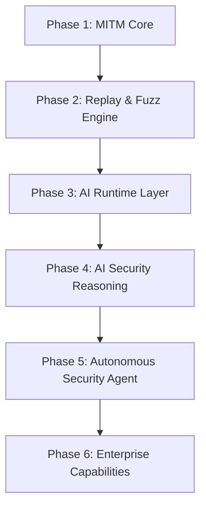

# 路线图

FlowMind 的长期目标是成为 AI-Native Application Security Platform。本文档描述产品的阶段规划与发展方向（与产品仓库 [flowmind-docs](https://github.com/G3G4X5X6/flowmind-docs) v1.0.0 基线对齐）。

## 产品方向

FlowMind 不仅仅是一个 MITM 代理或传统安全工具替代品，而是逐步演进到：

- AI-Native Application Security Platform
- AI Security Workbench

路线图的重点将转向：

1. 更强的上下文组织能力
2. 更强的 Replay / Fuzz 能力
3. 更强的 AI 推理与建议能力
4. 更强的攻击链和工作流理解能力

## 当前基线 (v1.0.0)

当前版本已具备的主要能力：

- ✅ Rust 内嵌 MITM 代理（HTTP / HTTPS / WebSocket 捕获）与拦截器（Hold / Modify / Drop）
- ✅ Flow 持久化与事件回推、项目管理、日志查看
- ✅ Repeater（原始 + 结构化、重发历史）、**序列器**（编排 / 变量 / 断言 / 序列 Fuzz）、Fuzzer（多策略、并发/限速/取消）
- ✅ 被动扫描 + Rhai 工作区脚本规则（内置被动 28 条 + 主动 8 条）与主动扫描配置
- ✅ AI 子系统：多 Provider 聊天、Tool Calling、MCP、Skills、子代理委派、自治重放/模糊
- ✅ HTML 报告包 / JSON / PDF 报告导出与素材剪藏

::: info AI 能力收缩（2026-09-29）
知识库 / RAG、旧版安全记忆、Attack Map 与相关 offensive 工作流已下线；公开文档以当前 AI 窗口能力为准（见 [AI 功能](../guide/ai.md)）。
:::

从路线图角度看，Phase 1/2 主体与 Phase 3 主链路已落地；原 Phase 4「AI 安全推理」中的图谱/RAG 方向不再是当前规划重点。

## 路线图总览

## Phase 1: MITM Core

**状态：✅ 已完成**

建立稳定的代理、证书、WebSocket、流量存储与事件推送能力。

## Phase 2: Replay & Fuzz Engine

**状态：✅ 已完成**

构建请求重放、序列编排与模糊测试能力，支持多策略与并发控制。

## Phase 3: AI Runtime Layer

**状态：✅ 基本完成**

多 Provider、工具调用、MCP、Skills 与智能重放/模糊主链路。

## Phase 4: AI Security Reasoning

**状态：⬜ 规划中（范围已调整）**

聚焦可落地的用户流程（如工作流发现、AI 辅助分析），不再以已下线的图谱/RAG 子系统为交付目标。

## Phase 5: Autonomous Security Agent

**状态：⬜ 规划中**

自治安全代理：自动重放、模糊测试、攻击链与漏洞验证等任务。

## Phase 6: Enterprise Capabilities

**状态：⬜ 规划中**

企业级协作与管理能力：团队协作、共享工作区、审计日志、权限管理与 SSO 等。

## 优先级视图

| 层级 | 重点 |
|------|------|
| MVP / P0 | HTTPS MITM、WebSocket、Flow Pipeline、Replay、AI Runtime、Tool Calling |
| P1 | 上下文预算与压缩、工作流发现、智能重放 / 认证上下文 |
| P2 | 系统托盘、主题、插件生态、团队协作等外围能力 |

## 参与贡献

如果您对路线图中的某个方向感兴趣，欢迎：

- 在 [文档仓库 Issues](https://github.com/G3G4X5X6/flowmind-docs/issues) 讨论文档改进
- 提交 Pull Request 改进公开文档或插件示例
- 在 [flowmind-docs Issues](https://github.com/G3G4X5X6/flowmind-docs/issues) 反馈产品问题

## 相关链接

- [贡献指南](./contributing.md)
- [架构概览](./architecture.md)
- [FlowMind 产品仓库](https://github.com/G3G4X5X6/flowmind-docs)
