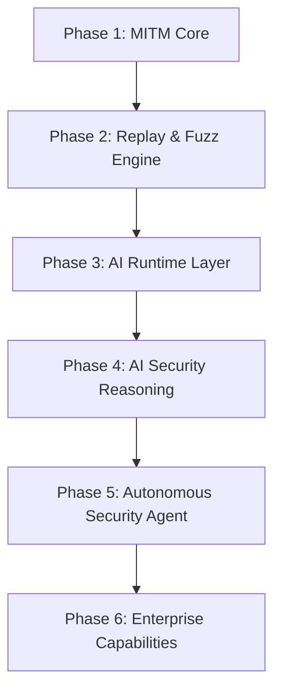

# Roadmap

FlowMind aims to become an AI-Native Application Security Platform. This page outlines phased plans aligned with the [flowmind-docs](https://github.com/G3G4X5X6/flowmind-docs) v1.0.0 baseline.

## Product direction

FlowMind is evolving beyond a MITM proxy or Burp alternative toward:

- AI-Native Application Security Platform
- AI Security Workbench

Focus areas:

1. Stronger context organization
2. Stronger replay / fuzz capabilities
3. Stronger AI reasoning and recommendations
4. Better attack-chain and workflow understanding

## Current baseline (v1.0.0)

Shipped capabilities include:

- ✅ Embedded Rust MITM (HTTP / HTTPS / WebSocket) and interceptor (Hold / Modify / Drop)
- ✅ Flow persistence, project management, logging
- ✅ Repeater, **sequencer** (orchestration / variables / assertions / sequence fuzz), fuzzer
- ✅ Passive scan + Rhai workspace rules (28 passive + 8 active built-ins) and active scan config
- ✅ AI: multi-provider chat, tool calling, MCP, Skills, delegation, smart replay/fuzz
- ✅ HTML report bundle / JSON / PDF export and clipping

::: info AI scope change (2026-09-29)
Knowledge base / RAG, legacy memory UI, Attack Map, and related offensive workflows were removed. Public docs follow the current AI window (see [AI Features](../guide/ai.md)).
:::

Phases 1–2 and the main Phase 3 path are largely complete. Former Phase 4 graph/RAG deliverables are no longer the active plan.

## Overview

## Phases

| Phase | Status | Notes |
|-------|--------|-------|
| 1 MITM Core | ✅ Done | Proxy, certs, WebSocket, storage |
| 2 Replay & Fuzz | ✅ Done | Repeater, sequencer, fuzzer |
| 3 AI Runtime | ✅ Mostly done | Providers, tools, MCP, Skills |
| 4 AI reasoning | ⬜ Planned (rescoped) | Practical flows; not graph/RAG revival |
| 5 Autonomous agent | ⬜ Planned | Automated validation workflows |
| 6 Enterprise | ⬜ Planned | Teams, audit, SSO |

## Priority view

| Tier | Focus |
|------|-------|
| P0 | MITM, WebSocket, flows, replay, AI runtime, tools |
| P1 | Context budget, workflow discovery, smart replay |
| P2 | Tray, themes, plugin ecosystem, collaboration |

## Contribute

- [Docs issues](https://github.com/gougu-security/flowmind-docs/issues)
- [Product issues](https://github.com/G3G4X5X6/flowmind-docs/issues)
- [Contributing guide](./contributing.md)

## See also

- [Architecture](./architecture.md)
- [FlowMind repository](https://github.com/G3G4X5X6/flowmind-docs)
